<picture>
  <source media="(prefers-color-scheme: dark)" srcset="./art/header-dark.webp" />
  <source media="(prefers-color-scheme: light)" srcset="./art/header-light.webp" />
  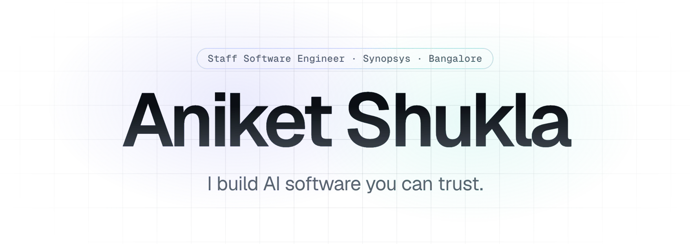
</picture>

  &nbsp;
  &nbsp;
  

### Selected work

<a href="https://github.com/aniketshukla1/superuser"><picture><source media="(prefers-color-scheme: dark)" srcset="./art/cards/superuser-dark.webp" /><source media="(prefers-color-scheme: light)" srcset="./art/cards/superuser-light.webp" />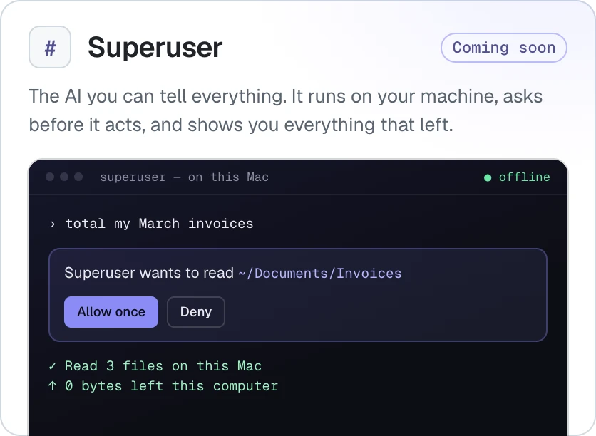</picture></a>
<a href="https://github.com/aniketshukla1/glaux"><picture><source media="(prefers-color-scheme: dark)" srcset="./art/cards/glaux-dark.webp" /><source media="(prefers-color-scheme: light)" srcset="./art/cards/glaux-light.webp" />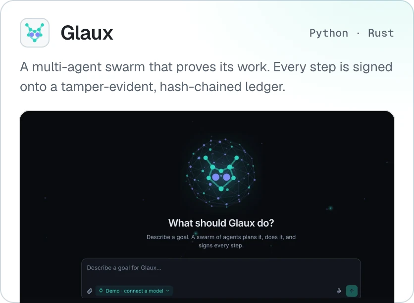</picture></a>
<a href="https://github.com/aniketshukla1/athenadb"><picture><source media="(prefers-color-scheme: dark)" srcset="./art/cards/athenadb-dark.webp" /><source media="(prefers-color-scheme: light)" srcset="./art/cards/athenadb-light.webp" />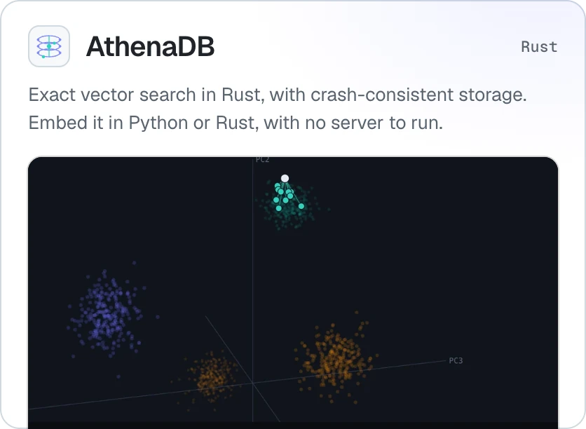</picture></a>
<a href="https://github.com/aniketshukla1/root"><picture><source media="(prefers-color-scheme: dark)" srcset="./art/cards/root-dark.webp" /><source media="(prefers-color-scheme: light)" srcset="./art/cards/root-light.webp" />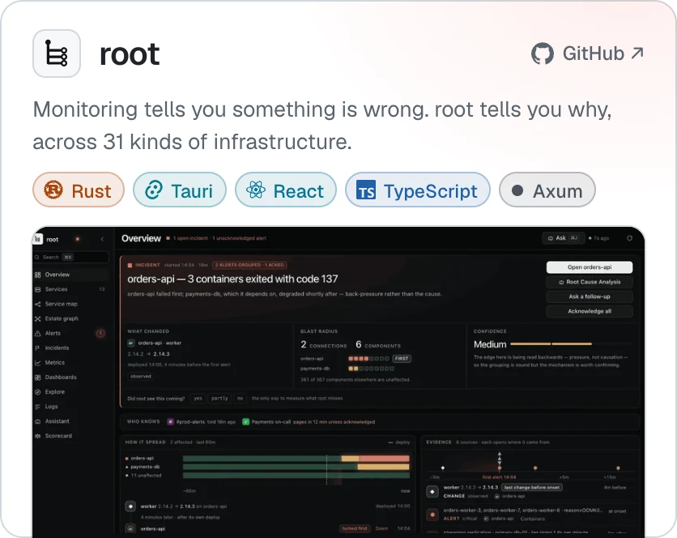</picture></a>
<a href="https://github.com/aniketshukla1/ferro"><picture><source media="(prefers-color-scheme: dark)" srcset="./art/cards/ferro-dark.webp" /><source media="(prefers-color-scheme: light)" srcset="./art/cards/ferro-light.webp" />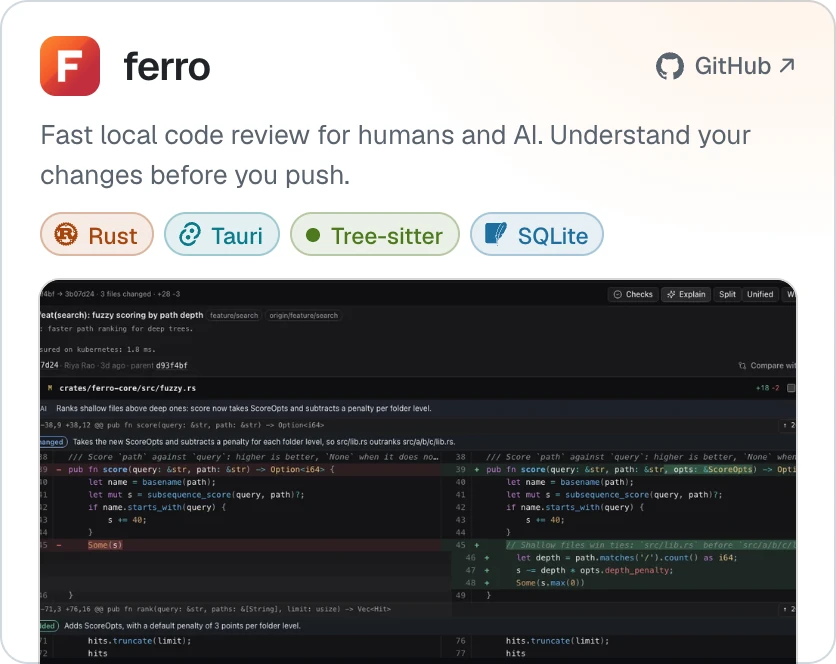</picture></a>
<a href="https://github.com/mnesio/mnesio"><picture><source media="(prefers-color-scheme: dark)" srcset="./art/cards/mnesio-dark.webp" /><source media="(prefers-color-scheme: light)" srcset="./art/cards/mnesio-light.webp" />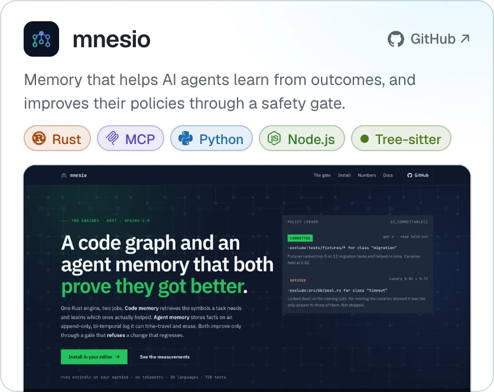</picture></a>
<a href="https://github.com/aniketshukla1/murmuration"><picture><source media="(prefers-color-scheme: dark)" srcset="./art/cards/murmuration-dark.webp" /><source media="(prefers-color-scheme: light)" srcset="./art/cards/murmuration-light.webp" />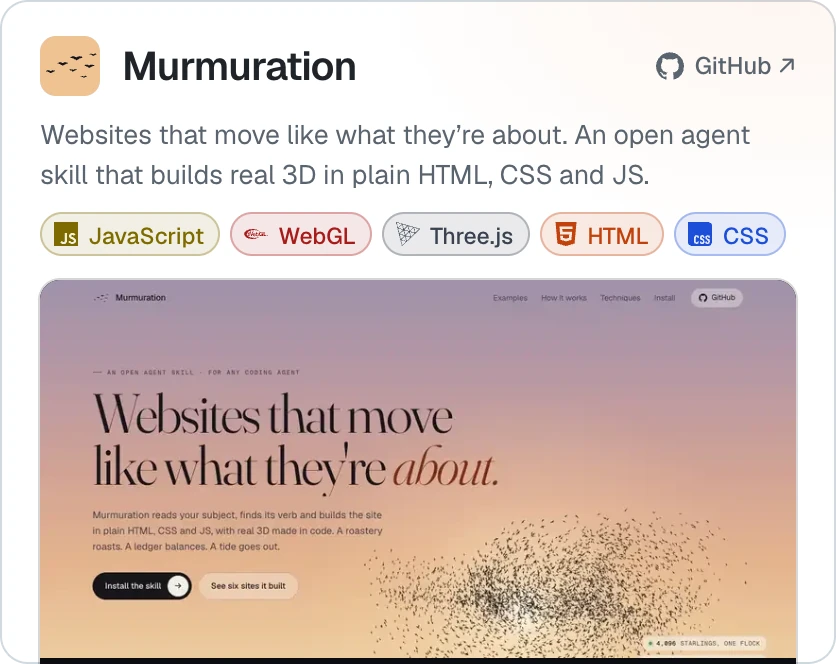</picture></a>
<a href="https://github.com/aniketshukla1/fiddlehead"><picture><source media="(prefers-color-scheme: dark)" srcset="./art/cards/fiddlehead-dark.webp" /><source media="(prefers-color-scheme: light)" srcset="./art/cards/fiddlehead-light.webp" />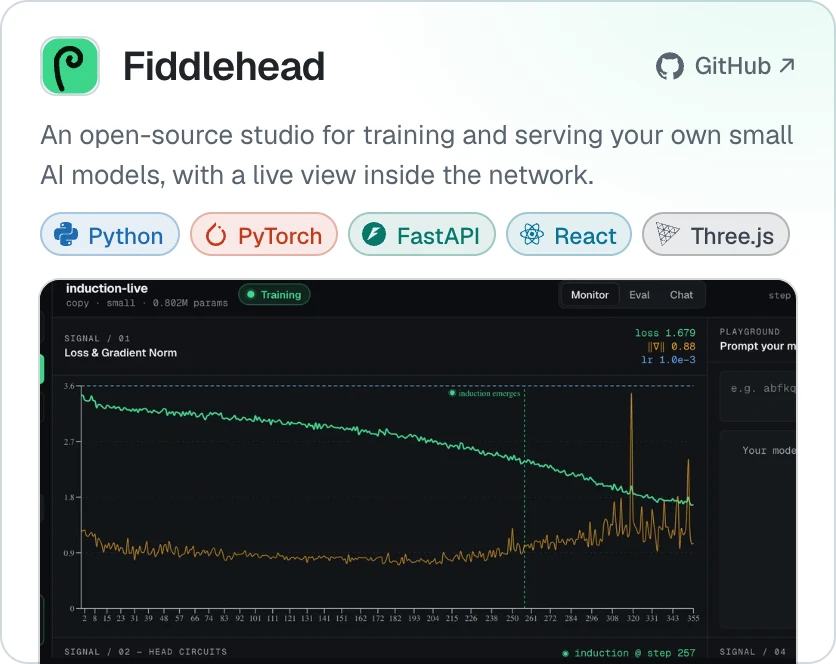</picture></a>
<a href="https://github.com/aniketshukla1/sdlc-kit"><picture><source media="(prefers-color-scheme: dark)" srcset="./art/cards/sdlc-kit-dark.webp" /><source media="(prefers-color-scheme: light)" srcset="./art/cards/sdlc-kit-light.webp" />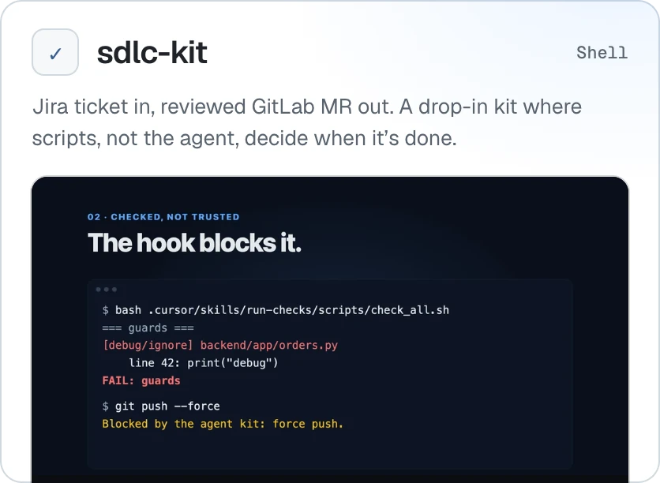</picture></a>
<a href="https://github.com/aniketshukla1/agent-cli"><picture><source media="(prefers-color-scheme: dark)" srcset="./art/cards/agent-cli-dark.webp" /><source media="(prefers-color-scheme: light)" srcset="./art/cards/agent-cli-light.webp" />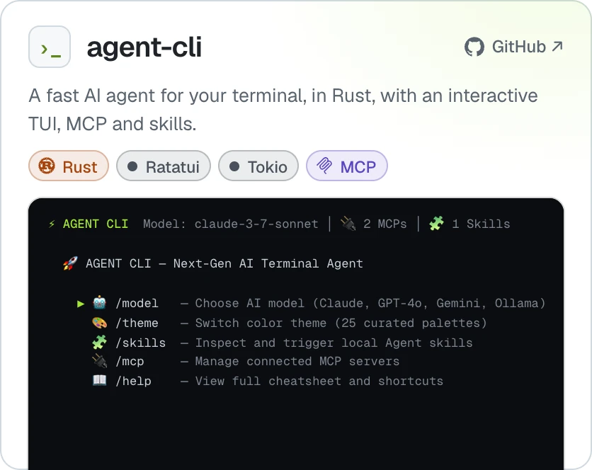</picture></a>

Websites: [Glaux](https://aniketshukla1.github.io/glaux/) · [AthenaDB](https://aniketshukla1.github.io/athenadb/) · [root](https://aniketshukla1.github.io/root/) · [ferro](https://aniketshukla1.github.io/ferro/) · [mnesio](https://mnesio.github.io/mnesio/) · [Murmuration](https://aniketshukla1.github.io/murmuration/) · [Fiddlehead](https://aniketshukla1.github.io/fiddlehead/) · [sdlc-kit](https://aniketshukla1.github.io/sdlc-kit/)

### Open source

180+ merged pull requests in other people's projects.

| Project | Work | Merged |
|---|---|---:|
| [Floci](https://github.com/floci-io/floci/pulls?q=is%3Apr+author%3Aaniketshukla1+is%3Amerged), the free local AWS emulator (30k stars) | Step Functions, AppSync, EventBridge, CloudFormation, Lambda, ECR, Route 53 and more | 171 |
| [KiroCrew](https://github.com/kirodotdev/KiroCrew/pulls?q=is%3Apr+author%3Aaniketshukla1+is%3Amerged) | Agent memory ranking, usage attribution, focus handling | 3 |
| [openworker](https://github.com/andrewyng/openworker/pulls?q=is%3Apr+author%3Aaniketshukla1+is%3Amerged) | macOS window restore and EventKit permissions | 2 |
| [OmniRoute](https://github.com/cheaper-inference/OmniRoute/pulls?q=is%3Apr+author%3Aaniketshukla1+is%3Amerged), [agent-orchestrator](https://github.com/OrchestratorInc/agent-orchestrator/pulls?q=is%3Apr+author%3Aaniketshukla1+is%3Amerged), [apexyard](https://github.com/me2resh/apexyard/pulls?q=is%3Apr+author%3Aaniketshukla1+is%3Amerged), [floci-az](https://github.com/floci-io/floci-az/pulls?q=is%3Apr+author%3Aaniketshukla1+is%3Amerged), [paperclip](https://github.com/joshuacox/paperclip/pulls?q=is%3Apr+author%3Aaniketshukla1+is%3Amerged) | API, CLI, hook and storage fixes | 5 |

### More projects

| Project | What it is | Year |
|---|---|---|
| [sdlc-workflow](https://github.com/aniketshukla1/sdlc-workflow) | Paste a Jira key, get a merged MR: one skill that takes an issue end to end in any coding agent | 2026 |
| [design-skill-evaluation](https://github.com/aniketshukla1/design-skill-evaluation) | A measured evaluation of an AI design skill, with a reusable WCAG contrast auditor | 2026 |
| [wc_tool](https://github.com/aniketshukla1/wc_tool) | A word count tool like Unix `wc`, in Python | 2024 |
| [DSA-AlgoMaster-Solutions](https://github.com/aniketshukla1/DSA-AlgoMaster-Solutions) | AlgoMaster data structures and algorithms problems, solved in Python | 2024 |
| [DSA-Neetcode-Solutions](https://github.com/aniketshukla1/DSA-Neetcode-Solutions) | NeetCode problems, solved in Python | 2024 |
| [booking-app](https://github.com/aniketshukla1/booking-app) | A ticket booking CLI, written to learn Go | 2023 |
| [cli_quiz_app](https://github.com/aniketshukla1/cli_quiz_app) | A command-line quiz app in JavaScript | 2021 |
| [Leetcode-May-Challenge](https://github.com/aniketshukla1/Leetcode-May-Challenge) | Python solutions, with time and space complexity | 2020 |
| [NotesApp](https://github.com/aniketshukla1/NotesApp) | A notes app for Android, in Java | 2020 |
| [ProStore](https://github.com/aniketshukla1/ProStore) | The ProStore app for Android, in Java | 2020 |
| [Vanwale_Application](https://github.com/aniketshukla1/Vanwale_Application) | The Vanwale mobile app | 2020 |
| [alien_game](https://github.com/aniketshukla1/alien_game) | An alien invasion game in Python | 2020 |
| [Ui_Development](https://github.com/aniketshukla1/Ui_Development) | Front-end development in HTML, CSS and JavaScript | 2020 |
| [DentistApp](https://github.com/aniketshukla1/DentistApp) | A dentist app in React Native | 2019 |

### Activity

<picture>
  <source media="(prefers-color-scheme: dark)" srcset="./activity-dark.svg" />
  <source media="(prefers-color-scheme: light)" srcset="./activity-light.svg" />
  
</picture>
